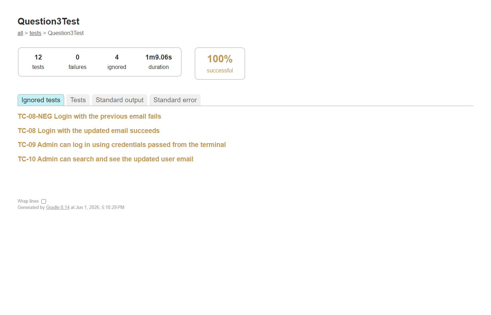

# Assignment 2 - Selenium WebDriver Automation

## Project Overview
This project contains two Selenium WebDriver automation tasks built with Java, JUnit 5, and Gradle.

---

## Task 1: Student Registration Form Automation (Question1.java)
Automates filling out and submitting a student registration form on the TutorialsPoint Selenium practice page.

**Website:** https://www.tutorialspoint.com/selenium/practice/selenium_automation_practice.php

**What it does:**
- Fills in Name, Email, Gender, Mobile, Date of Birth, Subjects, Hobbies
- Uploads a file, enters Address, selects State and City
- Submits the form and asserts all fields were filled correctly

### Recorded Video - Task 1
[Task 1 Video](https://drive.google.com/file/d/1Z_q-8qpK0gpmDZ1UtzO9iU95OnQXZoz0/view?usp=drive_link)

### Test Report Screenshot - Task 1
<!-- Add your report screenshot below -->


---

## Task 2: DSE Stock Price Web Scraping (Question2.java)
Scrapes stock price data from the Dhaka Stock Exchange (DSE) website and stores it in a text file.

**Website:** https://dsebd.org/latest_share_price_scroll_by_value.php

**What it does:**
- Navigates to the DSE latest share price page
- Extracts all table data using JavaScript execution
- Saves the data to `dse_table_data.txt` in tab-separated format
- Asserts that data rows were successfully scraped

### Recorded Video - Task 2
[Task 2 Video](https://drive.google.com/file/d/13RlqShaBXgITQzaOJhzdxBOeRuH7wz8G/view?usp=drive_link)

### Test Report Screenshot - Task 2
<!-- Add your report screenshot below -->


---

## Task 3: DailyFinance End-to-End (Question3Test.java)
End-to-end Selenium automation against a small SPA finance app, built on the **Page Object Model** with shared utilities.

**Website:** https://dailyfinance.roadtocareer.net/

**What it does (12 ordered JUnit tests):**
1. Registers a fresh `nusratrita00+{random}@gmail.com` user and asserts the congratulations message.
2. Two **negative** forgot-password cases — empty email and invalid format.
3. Sends a real reset link to the registered Gmail.
4. Pops a dialog and waits while the tester pastes the reset URL from Gmail, then sets a new password.
5. Logs in with the new password.
6. Adds two items — one with **all fields**, one with **mandatory fields only** — and asserts both appear in the item list.
7. Updates the profile email to a new Gmail and verifies the change **persisted** (reopens the profile and confirms the new email).
8. Asserts login with the **updated** email succeeds and login with the **previous** email fails.
9. Logs in as admin using credentials supplied at the terminal (`-Dadmin.email`, `-Dadmin.password`).
10. Searches the updated user email in the admin dashboard and asserts the matching row appears.

> **Result of a full run:** all 12 ordered tests pass.

### Implementation note (SPA quirk)
The profile is a client-rendered SPA. After navigating to the profile view, the page object performs a **one-time hard refresh** before editing — without it, an Update submitted against the not-yet-fully-bound React form is silently dropped (no error, change not saved). Refreshing so the form is fully loaded makes the update save reliably. Admin login lands on the `/admin` user table, which the test detects via the always-present search box (`/admin` URL + "Search by any field or date…" input).

### Architecture (POM)
```
src/test/java/
├── pages/        # Page Object classes (BasePage + 9 page objects)
├── utils/        # DriverFactory, ConfigReader, RandomDataGenerator,
│                 # ConsoleHelper, ScreenshotUtil, TestContext
└── tests/        # Question3Test.java (12 ordered tests)
```

### Test Cases
Standard test case spec lives at [docs/Question3_TestCases.md](docs/Question3_TestCases.md).

### Recorded Video - Task 3
[Task 3 Video](https://drive.google.com/drive/folders/1nhtBUsF-pT_VpfwIl7iKBZQsAKNi_i1C?usp=sharing)

### Test Report Screenshot - Task 3
<!-- Add your report screenshot below after running ./gradlew test --tests "tests.Question3Test" -->


---

## How to Run

### Prerequisites
- Java JDK 11+
- Google Chrome browser installed

### Run all tests
```bash
./gradlew test
```

### Run individual tests
```bash
./gradlew test --tests Question1
./gradlew test --tests Question2
```

### Run Task 3 (DailyFinance E2E)
```bash
# Admin credentials are passed as -D system properties — never committed.
./gradlew test --tests "tests.Question3Test" `
    -Dadmin.email=admin@test.com `
    -Dadmin.password=admin123
```

When the test reaches **step 4** a small **dialog box** pops up (kept always-on-top).
Open the registered Gmail inbox, copy the latest "Reset Password" link, paste it into
the dialog, and click **OK** — the suite resumes automatically.

### View Test Reports
After running tests, open the HTML report at:
```
build/reports/tests/test/index.html
```

---

## Tech Stack
- **Java** - Programming language
- **Selenium WebDriver 4.27.0** - Browser automation
- **JUnit 5 (Jupiter)** - Testing framework
- **AssertJ 3.26** - Fluent assertions (Task 3)
- **Apache Commons Lang3** - Random test data (Task 3)
- **Gradle** - Build tool

## Project Structure (Task 3 follows POM)
```
selenium-junit-automation/
├── build.gradle.kts
├── settings.gradle.kts
├── .gitignore
├── README.md
├── docs/
│   └── Question3_TestCases.md
├── screenshots/
│   └── question3/        # auto-captured per step at runtime (gitignored)
└── src/
    └── test/
        ├── java/
        │   ├── pages/    # Page Object Model classes
        │   ├── utils/    # DriverFactory, ConfigReader, helpers
        │   └── tests/    # Question3Test.java
        └── resources/
            ├── config.properties.example   # committed template
            └── config.properties           # gitignored, your local values
```
